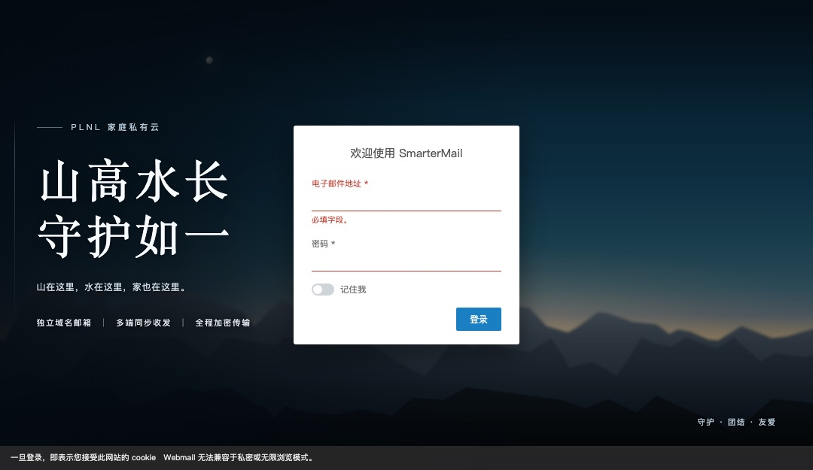
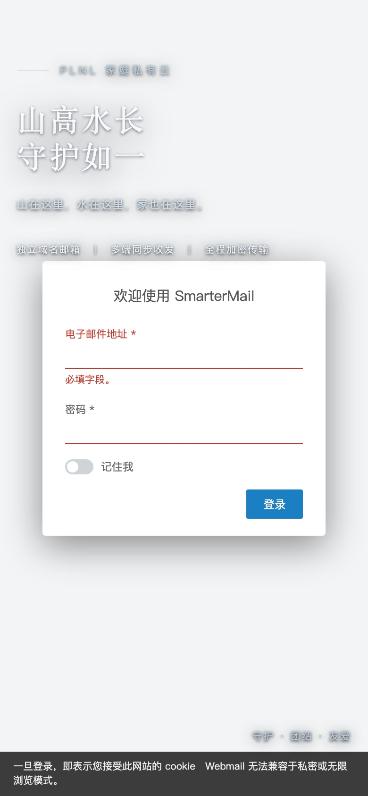
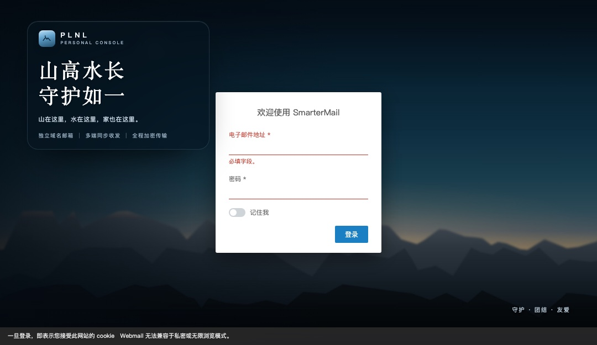
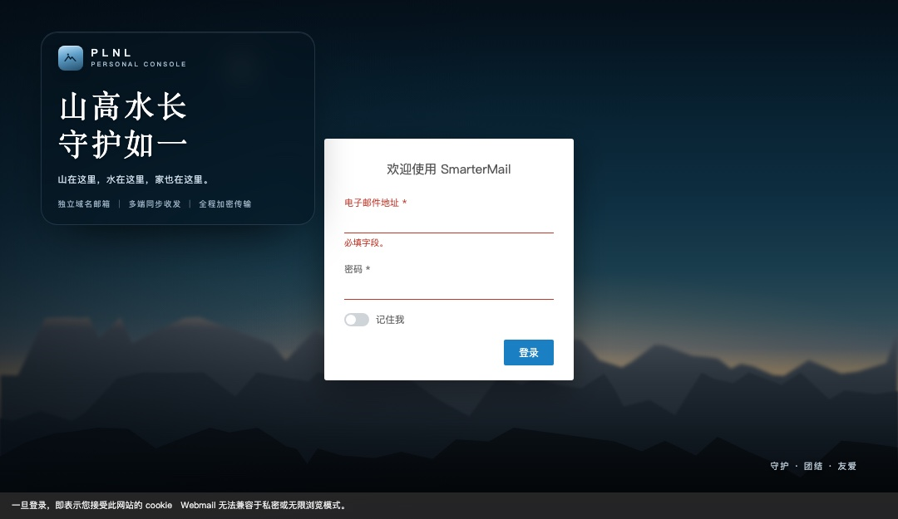
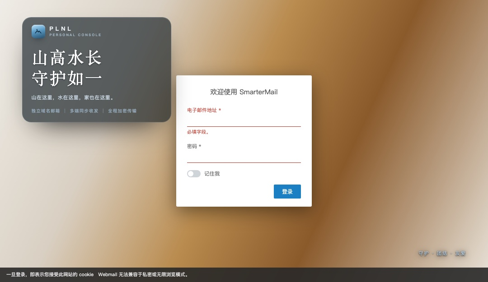
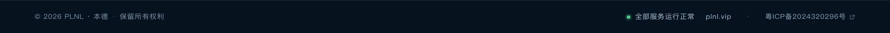
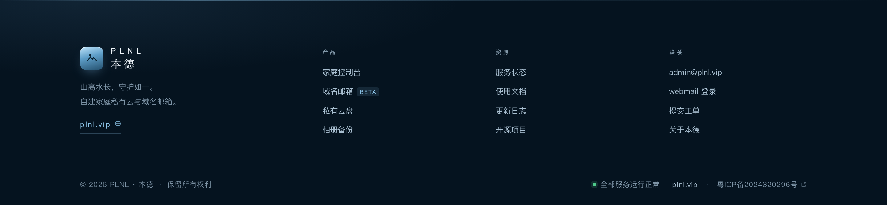

# NameCraneLogin

> 给 **NameCrane CraneMail / SmarterMail** 的 webmail 登录页换一张脸。
> 纯 HTML + 内联样式，**不写 `<style>`、不写 JS、不需要构建**，复制粘贴即生效。
>
> *A drop-in login page skin for NameCrane CraneMail / SmarterMail. Inline styles only — no `<style>` block, no JavaScript, no build step.*
>
> 仓库里另附一套同品牌的[站点页脚组件](footer/)，供配套站点使用。



---

## 这个仓库解决什么问题

NameCrane（SmarterMail 内核）允许在后台自定义登录页 HTML，但实际用起来有一堆坑，是踩完之后总结出来的：

1. **`<style>` 会被整段过滤。**
   后台那个「登录页面的 HTML」框是富文本编辑器，`<style>`、`<script>` 会被剥掉，只留下 `style=""` 内联属性。
   所以网上流传的 `body, #login_page_container { background-image: ... }` 那段 CSS，在**域名设置**这个框里是无效的（它在 NameCrane 的 Customization / Branding 后台才有效）。

2. **不能用 class、伪元素、`:hover`、`@media`。**
   没有 `<style>` 就没有选择器，一切只能写在元素的 `style=""` 里。装饰性的分隔线、细光线只能用真实元素画出来。

3. **整屏背景层不能用负 `z-index` 硬铺。**
   `position:fixed; z-index:-1` 的背景层，如果登录容器（`#login_page_container`）自带背景图并且是定位元素，就会被它压住 —— 皮肤直接隐身。所以本项目的背景有两种策略：用**照片直链**（v6），或者干脆**不用整屏层**（v7，交给系统背景）。

4. **系统那张白色登录卡改不了。**
   字段只能插入 HTML，够不到系统的表单元素。想要深色玻璃卡片，只能改 SmarterMail 登录模板文件，见 [`design/`](design/)。

---

## 三个版本

三个文件互相独立，用哪个就贴哪个。

### v7 · 悬浮文案版（推荐）

没有底板，纯粹靠图片的暗部承载文字：左侧细光线 + 短横线小标题 + 大标题 + 一行标签。


- 文件：[`snippets/v7-floating.html`](snippets/v7-floating.html)
- 适合：背景图够暗、想要最干净的排版
- 手机端：副标题和标签会缩小，整块自动上移避开登录卡

<p align="center">
  
</p>

### v6 · 玻璃牌版（背景用你自己的照片）

文案装在一块深色半透明玻璃牌里，背景是一张照片直链；照片挂了会自动退回深色渐变。



- 文件：[`snippets/v6-glass-panel-photo.html`](snippets/v6-glass-panel-photo.html)
- 适合：背景偏亮、或者背景能不能生效不确定的时候 —— 牌子自带底色，字一定能读

### v5 · 玻璃牌版（纯 CSS 夜景）

和 v6 同一套排版，但背景完全由 CSS 渐变 + 内联 SVG 山脊画出来，**不依赖任何外部图片**。



- 文件：[`snippets/v5-glass-panel.html`](snippets/v5-glass-panel.html)
- 适合：不想传图、不想依赖图床

> v5 和 v6 的预览看起来一样，因为用的是同一张画 —— 区别只在**背景来源**：一个是 CSS 画的，一个是照片。

### 背景被系统挡住时

如果贴上后发现背景还是原来那张，说明 `#login_page_container` 把自己的背景压在 `z-index:-1` 之上。**代码不用改**，文案依然清晰：



想彻底换背景，按优先级：

1. 关掉「启用自定义登录页面 HTML」→ 上传「登录画面使用的图片」→ 再打开开关 → 保存
   （设置存在后端，关开关只是把 UI 藏起来，不代表值失效）
2. NameCrane 的 **Customization / Branding** 后台写 CSS
3. 改 SmarterMail 登录模板文件

---

## 快速开始

1. 打开 [`snippets/v7-floating.html`](snippets/v7-floating.html)（或 v6），**整段复制**。
2. 用域管理员登录 webmail → **域设置 → 常规**。
3. 找到 **登录显示画面**：

   | 字段 | 填什么 |
   | --- | --- |
   | 登录画面使用的图片 | 留空（背景由代码负责） |
   | 自订登录画面文本 | **清空**（否则会和代码里的文案重复两次） |
   | 自订标题文本 | `PLNL 登录 · 家庭私有云` ← 浏览器标签页标题 |
   | 启用自定义登录页面 HTML 代码 | ✅ 勾选 |
   | 登录页面的 HTML | 粘贴刚才复制的代码 |

4. 点「预览登录页面」确认，然后保存。

---

## 改起来

所有可改的地方都在文件里用中文注释标好了，搜关键词最快：

| 想改 | 搜什么 / 改哪 |
| --- | --- |
| 品牌名、Logo | `PLNL` / `PERSONAL CONSOLE` |
| 小标题 | `PLNL 家庭私有云` |
| 大标题 | `山高水长` |
| 副标题 | `山在这里` |
| 那行标签 | `独立域名邮箱` |
| 标题字号 | `font-size:clamp(32px,5.6vw,68px)` |
| 整块位置（v7） | `top:clamp(56px,14vw,190px)`，调大往下走 |
| 块宽 / 换行 | `width:min(80vw,360px)` |
| 玻璃牌透明度（v5/v6） | `rgba(7,19,29,.62)` 里的 `.62` |
| 背景图（v6） | 第 ①-1 段 `background-image:url('...')` |
| 左侧压暗强度 | 第 ①-2 段的 `rgba(3,10,17,.78)` 那一组 |
| 手机端文案压到登录框 | 把 `top` 里的 `14vw` 调小（如 `10vw`） |

字号统一用 `clamp()` 做流体缩放 —— 因为没有 `@media` 可用，这是唯一能在内联样式里做响应式的办法。位置则用 `vw` 而不是 `vh`：屏幕越窄文案越往上收，正好避开居中的登录卡。

---

## 背景图

[`assets/login-bg.jpg`](assets/login-bg.jpg) 是本项目自带的夜景（1920×1080），可以直接拿去用：

```css
background-image: url('https://你的图床/xxx.jpg');
```

⚠️ 仓库示例里用的是一张免费图床的地址，长期可能失效。稳妥做法是把 `assets/login-bg.jpg` 传到自己域名下再改 URL（地址失效不会白屏，只会退回深色渐变）。

---

## 目录结构

```
NameCraneLogin/
├─ snippets/
│  ├─ v7-floating.html            ← 推荐
│  ├─ v6-glass-panel-photo.html
│  └─ v5-glass-panel.html
├─ previews/                       ← 效果图（1080×625 / 390×844）
├─ assets/
│  └─ login-bg.jpg
├─ design/
│  ├─ full-glass-card-reference.html   ← 完整玻璃卡片设计稿（需要 <style>，本字段做不到）
│  └─ full-glass-card-reference.jpg
├─ footer/                         ← 附赠：同品牌站点页脚（底栏 / 多列页脚）
│  ├─ bar.html · bar.css           ← 单行底栏（版权 / 状态 / 域名 / 备案）
│  ├─ footer.html · footer.css     ← 完整多列页脚（深色 / 浅色 / 紧凑）
│  ├─ bar-demo.html · index.html   ← 本地预览页
│  ├─ previews/
│  └─ README.md
├─ tools/
│  └─ build-preview.py            ← 把代码套进模拟登录页，本地看效果
└─ README.md
```

`tools/build-preview.py` 会生成一个「模拟 SmarterMail 登录页」的 HTML（白卡 + 底部 cookie 条 + 系统背景），用来验证皮肤能不能压住系统样式：

```bash
python3 tools/build-preview.py snippets/v7-floating.html previews/v7-demo.html
python3 tools/build-preview.py snippets/v6-glass-panel-photo.html out.html --system-bg   # 模拟背景被容器挡住
```

---

## 附：站点页脚组件

登录页之外，仓库里还放了一套同品牌的站点页脚，供 `plnl.vip` 这类配套站点使用。同样是纯 HTML + CSS，无 JS、无依赖。

**单行底栏**（最常用）— 版权 · 服务状态 · 域名 · 备案号：



```html
<link rel="stylesheet" href="footer/bar.css" />
<!-- 再把 footer/bar.html 贴到页面底部 -->
```

**完整多列页脚** — 品牌区 + 产品 / 资源 / 联系三列导航，带深色、浅色、紧凑三套变体：



细节见 [footer/README.md](footer/README.md)：令牌表、浅色变体、响应式行为，以及备案号必须外链 `beian.miit.gov.cn` 的合规说明。

---

## FAQ

**Q：贴上去后一片空白？**
说明连 `style=""` 都被过滤了，或者服务商会话过期。先只贴一个 `<div style="color:#fff">test</div>` 验证字段是否可用。

**Q：文字压到登录卡了？**
v7 调小 `top` 里的 `14vw`；v5/v6 调小 `top:clamp(12px,6vh,140px)` 里的 `6vh`，或把 `width` 收窄。

**Q：能改那张白色登录卡吗？**
不能。这个字段没有选择器。要改只能动 SmarterMail 的登录模板文件，或走 Branding 后台的 CSS。

**Q：为什么代码里没有 `<style>`？**
因为会被过滤。详见开头的「这个仓库解决什么问题」。

**Q：兼容哪些版本？**
NameCrane CraneMail（SmarterMail 内核）已在 v15/16 风格的登录页上验证。理论上任何允许自定义登录 HTML 的 SmarterMail 发行版都可用，样式是否生效取决于它是否过滤 `<style>`。

---

## English

A drop-in custom login page for **NameCrane CraneMail / SmarterMail**.

SmarterMail's "custom login page HTML" field is a rich-text editor: it **strips `<style>` and `<script>`** and keeps only inline `style=""` attributes. That means no classes, no pseudo-elements, no `@media`, no `:hover`. Everything here is inline styles on plain elements — decorative rules are real 1px `<div>`s, and responsiveness is done with `clamp()` / `vw` units instead of media queries.

Three variants:
- **v7** (recommended) — floating typography, no panel, relies on a dark background image
- **v6** — same type layout inside a dark glass panel, background from a photo URL
- **v5** — glass panel with a background painted entirely in CSS + inline SVG (no external assets)

Paste the file into **Domain Settings → General → Login Screen → "Enable custom login page HTML"**, clear "custom login screen text" (or it will show twice), and preview.

System login card itself cannot be restyled from this field (no CSS selectors reachable). Use the template files under `design/` as the target if you have FTP access.

---

## License

MIT —— 随意使用、修改、商用。图片素材可自由替换。
