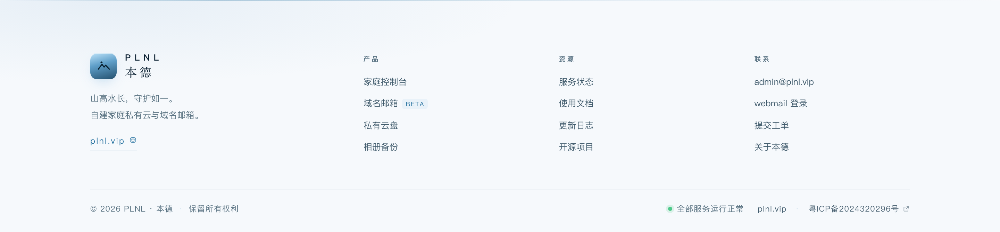
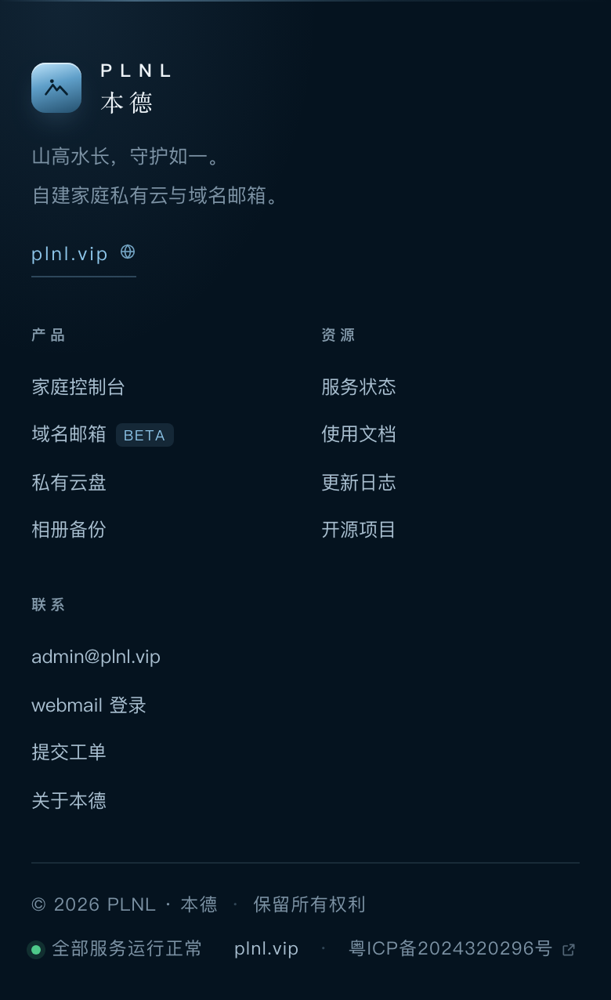

# PLNL · 本德 — 站点页脚

围绕 **PLNL**、**本德** 与域名 **plnl.vip** 组织的页脚组件。纯 HTML + CSS，无 JS、无依赖。

## ① 独立底栏（单行，最常用）

只要一行：版权 · 服务状态 · 域名 · 备案号。`bar.css` 自带全部令牌，**不依赖 footer.css**。


```html
<link rel="stylesheet" href="bar.css" />
<!-- 然后把 bar.html 的内容整段贴到页面底部 -->
```

| 文件 | 说明 |
| --- | --- |
| `bar.html` | 底栏结构，复制这一段即可 |
| `bar.css` | 独立样式（含 `.plnl-bar--light` 浅色变体） |
| `bar-demo.html` | 深色 + 浅色对照预览 |

宽度：默认满宽 + `clamp(20px,4vw,56px)` 内边距；超宽屏（>1600px）内容自动收边居中。≤720px 转两行：版权一行，状态/域名/备案一行。


## ② 完整多列页脚

想带品牌区 + 导航分栏时用这套：


## 文件

| 文件 | 说明 |
| --- | --- |
| `footer.html` | 完整版页脚结构与文案 |
| `footer.css` | 全部样式，含深色 / 浅色 / 紧凑三套变体 |
| `index.html` | 交付预览页（三种形态同屏对比），双击可看 |
| `build.py` | 由 `footer.html` 组装 `index.html`，改完页面重跑一次即可 |
| `previews/` | 效果图：深色 / 浅色 / 紧凑 / 移动端 |

## 用法

```html
<!-- 1. 引入样式（放在 <head> 或页面末尾均可） -->
<link rel="stylesheet" href="/assets/plnl/footer.css" />

<!-- 2. 把 footer.html 的内容整段贴到页面底部 -->
```

要换肤只改 `footer.css` 顶部的 `--f-*` 变量，不要去改具体规则：

| 变量 | 深色 | 浅色 | 作用 |
| --- | --- | --- | --- |
| `--f-bg` | `#05131f` | `#f6f9fc` | 底色 |
| `--f-ink` | `#eef4f9` | `#0d2233` | 标题 / 强调文字（含「本德」） |
| `--f-soft` | `#a9bfd0` | `#3f5a6b` | 正文与链接 |
| `--f-mute` | `#7d93a5` | `#5a7382` | 说明文字、版权行 |
| `--f-accent` | `#8ec6ea` | `#1f6d9c` | 悬停、域名、状态 |

## 三套形态

| 形态 | class | 用在哪 |
| --- | --- | --- |
| 深色完整版 | `.plnl-footer` | 主站、控制台（默认） |
| 浅色变体 | `.plnl-footer.plnl-footer--light` | 白底页面、文档站、打印 |
| 紧凑版 | `.plnl-footer.plnl-footer--compact` | 登录页、单页、内容轻的页面 |




移动端（≤560px）自动换成两列导航 + 纵向底栏：



## 备案信息（合规要点）

底栏的「粤ICP备2024320296号」是**必须可点击**的，且要指向工信部备案系统，代码里已经写好：

```html
<a class="plnl-icp" href="https://beian.miit.gov.cn/" target="_blank" rel="noopener noreferrer">
  粤ICP备2024320296号
</a>
```

几条别踩的：

- 备案号要**完整显示**（省份简称 + ICP备 + 数字 + 号），不要缩写成"粤ICP备…"或把它做成图片
- 必须出现在**首页页脚**，且指向 `https://beian.miit.gov.cn/`（不是自己的站内页）
- 如果以后办了**公安联网备案**，在同一位置再加一条，指向 `https://beian.mps.gov.cn/`，格式如 `粤公网安备 4403xxxxxxxxxxx号`
- 页脚里的 ICP 号只是展示，**不代表**已经通过备案；主体、域名、接入商三者要一致

## 可访问性

- 正文 `#a9bfd0` 对 `#05131f` ≈ 10:1，次要文字 ≈ 5.7:1，均高于 WCAG AA 的 4.5:1；浅色变体的次要文字也压到了 4.6:1 以上
- 所有链接有 `:focus-visible` 焦点环（2px 强调色 + 3px 偏移），键盘可完整走完
- 链接悬停同时改变颜色与下划线（不只是颜色），不依赖单一视觉通道
- 尊重 `prefers-reduced-motion`，关掉动效后布局不变
- 三个导航块都用 `<nav aria-labelledby>` 命名，读屏能念出"产品 / 资源 / 联系"

## 改内容

搜这些词最快：

| 想改 | 搜 |
| --- | --- |
| 品牌中英文 | `PLNL` / `本德` |
| 一句话介绍 | `山高水长，守护如一` |
| 域名 | `plnl.vip` |
| 导航分组与链接 | `plnl-col__title` 附近的 `<li>` |
| 版权行 | `© 2026` |
| 备案号 | `粤ICP备` |
| 服务状态文案 | `全部服务运行正常` |

链接目前指向的是占位地址（`https://plnl.vip`、`https://mail.plnl.vip`、GitHub 仓库），按实际情况替换。

---

MIT · 可自由修改商用
